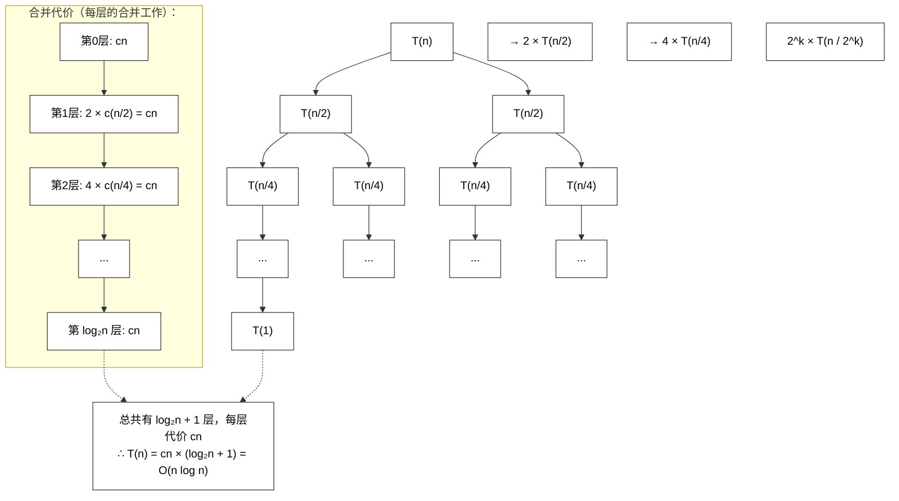
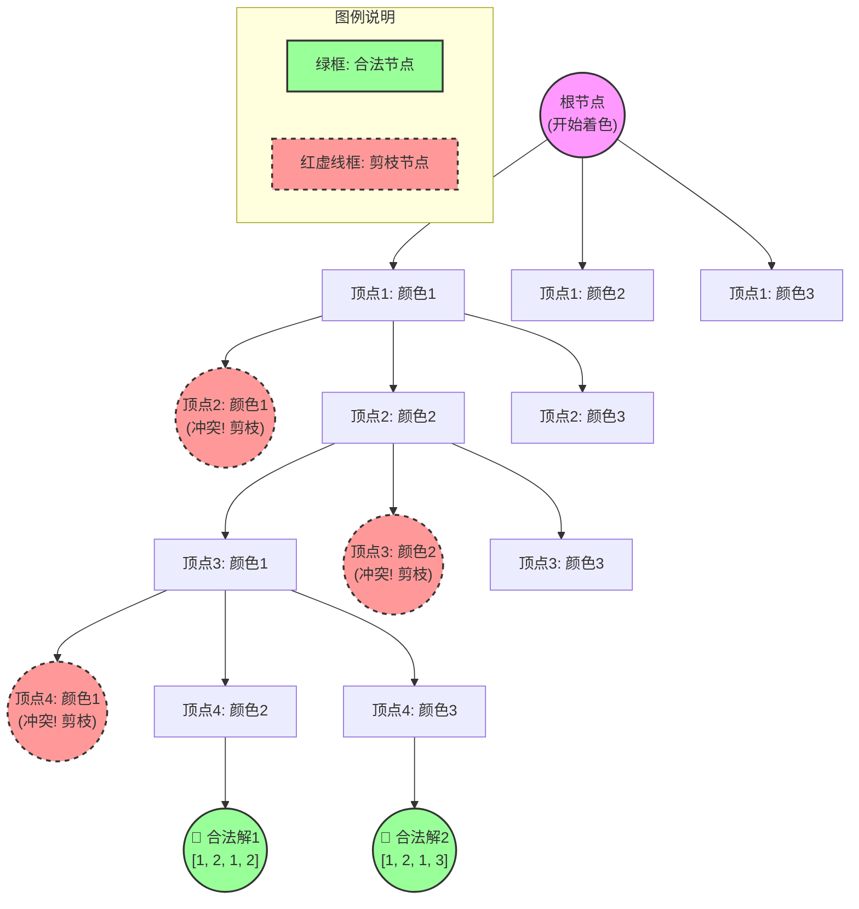
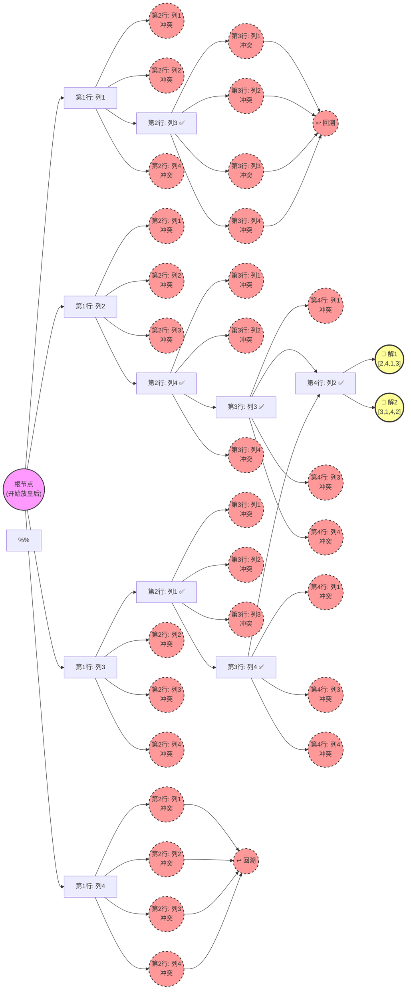

 ```toc
 ```
# 分治算法
1. 分治三步骤，分解子问题，求解子问题，合并子问题，三步求解问题
2. 写伪代码。伪代码不用担心要写那些算法求解具体的过程，这会直接给出来，写的部分是分解子问题，调用这求解函数，和写递归函数部分
3. 写时间复杂度T(.)=..,.根据这个式子用递归树，或者主定理求解得到复杂度O(.)。用递归树求解，要画出归树，就算不出来，递归树也可以得到份分；用主定理求解，要写出符合的几个条件，根据主定理第几条得到结果。
## 归并排序（MergeSort）
### 1. 分治算法的三个步骤
结合题目图片中的文字，分治算法求解问题的三大步为（直接背）：
1.  **划分（分解）**：将原问题分解为若干个**规模较小、相互独立且形式相同**的子问题。（归并排序中是按中间位置划分为两个等长子序列）。
2.  **求解子问题（解决）**：**递归**地求解这些子问题。若子问题规模足够小，则直接求解（递归边界）。（归并排序中是对左右子序列进行递归排序）。
3.  **合并**：将各个子问题的解**合并**成原问题的解。（归并排序中是合并两个有序子序列为一个有序序列）。
### 2. 分治算法伪代码
考试时重点要写对**递归调用**和**合并**的部分。归并排序标准伪代码（注意符号的写法，可以直接照抄）：
```c
MergeSort(A, left, right):
    // 1. 递归终止条件（子问题不可再分）
    if left >= right:
        return
    // 2. 分解子问题（找中间位置）
    mid = (left + right) / 2   // 向下取整
    // 3. 递归求解子问题
    MergeSort(A, left, mid)    // 对左半部分排序
    MergeSort(A, mid+1, right) // 对右半部分排序
    // 4. 合并子问题的解（这一步是具体操作，通常由题目给出或你写个调用）
    Merge(A, left, mid, right) // 调用合并函数，将两个有序子数组合并
```

**考试说明**：如果老师没要求写出 `MERGE` 的具体合并代码，写上面这几行即可。如果要求写 `MERGE` 内部的逻辑，重点说明它的本质是 **“逐个比较两个子序列的最小数，放入辅助数组，最后复制回原数组”**，其时间复杂度为 **\(O(n)\)**。
### 3. 时间复杂度推导（重点复习）
归并排序的时间复杂度递推式基本是固定的。你考试时可以把下面的两种方法都写一写，特别是第二种**主定理**，很容易拿分。
**【第一步】写出递推式 \(T(n)\)**
`T(n) = 2T(n/2) + O(n)
*   \(2T(n/2)\) 代表递归处理左右两个规模为 \(n/2\) 的子问题；
*   \(O(n)\) 代表最后一步合并操作，需要遍历所有元素。
**通过递推式求解最终时间复杂度 \(O(n \log n)\)，你有两种方法：**
#### ✅ 方法一：主定理（适合考试，写条件就得分）
**给定递推公式：** \(T(n) = 2T(n/2) + n\)
**第一步：** 将递推公式与主定理标准形式 \(T(n) = aT(n/b) + f(n)\) 比较，提取参数。
*   由上可知：\(a = 2\)，\(b = 2\)， \(f(n) = n\)。
**第二步：** 计算主定理中的临界函数 \(n^{\log_b a}\) 的值。
*   计算得： \(n^{\log_b a} = n^{\log_2 2} = n^1 = n\)。
**第三步：** 比较 \(f(n)\) 与 \(n^{\log_b a}\)，判定属于主定理的哪一种情况。
*   因为 \(f(n) = n\)，且 \(n^{\log_b a} = n\)。
*   所以满足 **\(f(n) = \(O(n \log n)\)。
*   由此判定，该递推式符合**主定理的第二种情况**。
**最终结果：** 该算法的时间复杂度为 **\(O(n \log n)\)** 
#### ✅ 方法二：递归树

# 动态规划
1. 写动态规划算法的三个性质。第一问大概率就问这个，背下来直接写就行
2. 写递归式，动态转移方程。 
看好是哪个算法，复习时候背好递推式子，动态转移方程。这个地方大概率考背包问题
3. 根据动态转移方程填表
递推的填表，之前实验课讲过，就和那一样的填表，看书和PPT复习
4. 根据表来写出某个输出结果
## 0/1背包问题
- 物品数量 n=4，背包容量 C=8
- 体积数组 w=[0,2,3,4,5]w=[0,2,3,4,5] （下标从1开始）
- 价值数组 v=[0,3,4,5,6]v=[0,3,4,5,6] （下标从1开始）
### 1. 动态规划算法的三个性质（背熟直接写）
采用自底向上的方式递推求值，并将中间结果存储起来便于后续计算。
动态规划算法通常适用于具有以下**三个基本性质**的问题：
1. **最优子结构**：问题的最优解包含了其子问题的最优解。
2. **重叠子问题**：在求解过程中，相同的子问题会被反复计算，可以通过存储（记忆化）来避免重复计算。
3. **无后效性**（或状态无后效性）：某阶段的状态一旦确定，就不受之后决策的影响，只与当前状态有关。
### 2. 递归式、动态转移方程（背诵并默写）
设 `dp[i][j]dp[i][j]` 表示**前 i 个物品，放入容量为 j 的背包所能获得的最大价值**。  
状态转移方程如下（分两种情况）：
dp`[i][j]={dp[i−1][j]
`dp[i][j]={dp[i−1][j]                  当 j<w[i] 时（背包容量不够，不能选第 i 个物品）
`max{dp[i−1][j], dp[i−1][j−w[i]]+v[i]}​  当 j≥w[i] 时（容量够，比较“不选”和“选”哪个价值大）​
- **边界条件**：`dp[0][j]=0（没有物品时价值为0），dp[i][0]=0（容量为0时价值为0）。
### 3. 根据动态转移方程填表
我们先构建一个 **5行9列** 的表格（行是物品编号0~4，列是背包容量0~8）。初始化第一行和第一列为0。

| 物品\容量           | 0   | 1   | 2     | 3     | 4     | 5     | 6     | 7     | 8      |
| --------------- | --- | --- | ----- | ----- | ----- | ----- | ----- | ----- | ------ |
| **0** (无)       | 0   | 0   | 0     | 0     | 0     | 0     | 0     | 0     | 0      |
| **1** (v=3,w=2) | 0   | 0   | **3** | 3     | 3     | 3     | 3     | 3     | 3      |
| **2** (v=4,w=3) | 0   | 0   | 3     | **4** | 4     | **7** | 7     | 7     | 7      |
| **3** (v=5,w=4) | 0   | 0   | 3     | 4     | **5** | 7     | **8** | **9** | 9      |
| **4** (v=6,w=5) | 0   | 0   | 3     | 4     | 5     | 7     | 8     | 9     | **10** |

_(注：表格中加粗的格子是每一行发生数值更新的关键节点，也就是容量足够放入当前物品且比不放的价值高。)_
### 4. 根据表写出某个输出结果（最终答案）
题目问的是：**背包最多能装入价值为多少的物品？**
**答案：** 最大值就是表格右下角，即 `dp[4][8]dp[4][8] 的值。  
**最大装入价值为：10**
**【扩展：多拿几分的小提示 - 回溯得出选中的物品】**  
如果在后续问题中问你**“具体选了哪几个物品”**，可以根据表格逆推（回溯）：
1. 从 `dp[4][8]=10` 开始反推。上一步是 `dp[3][3]+6 = 4+6 = 10`，所以**物品4被选中**，剩余容量 8−5=38−5=3。
2. 找 `dp[3][3]=4`。这一步来自于 `dp[2][0]+4 = 0+4 = 4`，所以**物品2被选中**。
3. 剩余容量 3−3=03−3=0，结束。  
    **结论：最优解为 物品2 + 物品4（总体积=3+5=8，总价值=4+6=10）。**
# 贪心算法
1. prim,Dij,kru三个算法正确性证明。
2. 给输入选择算法贪心求解问题
要写过程，和当初考数据结构时候类似。比如prim算法，先从一个点，然后不断扩展点，加入结合。kru,先给边排序，然后一步一步选择
这是一份关于**图论四大经典算法正确性证明**的极简背诵版。我把PPT里严谨的数学语言，全部转化成了**逻辑链条+关键句**，方便你理解和记忆。
### 核心思想（所有证明的通法）
所有贪心算法的证明都是一个套路：**数学归纳法**。
1. **开头**：证明第一步是对的（基础）。
2. **中间**：假设前`k`步是对的，证明第`k+1`步也是对的（归纳）。
3. **关键操作**：如果最优解里**没有**我这一步选的边，我就把最优解里的某条边**换掉**，换成我选的这条，结果**不比原来差**。
### 1. Prim算法（加点法）
**一句话核心**：**每次从已选点集往外连接的最短边，一定属于某棵最小生成树。**  
**记忆口诀**：选最短边，换掉回路中的长边。
- **证明逻辑**：
  - 假设前`k`步选的边都在某棵最优树`T`里。
  - 第`k+1`步选了一条最短边`e`连接S（已选点集）和V-S。
  - 如果`e`不在`T`里，那`T`加上`e`一定会形成一个**回路**。
  - 这个回路里必然有另一条边`f`，也连接着S和V-S。
  - 因为`e`是我们挑出来的最短边，所以`e`的长度肯定**≤**`f`的长度。
  - 用`e`换掉`f`，得到的新树`T'`同样是一棵生成树，而且**总权重不会增加**。
  - **结论**：所以存在一棵包含`e`的最优树，归纳成立。
### 2. Kruskal算法（加边法）
**一句话核心**：**每次选全局权值最小的安全边，一定是最优解的一部分。**  
**记忆口诀**：*先排序，从最小加，短接法证明。*
- **证明逻辑**：
  - 假设算法面对一个`k+1`个点的图`G`。
  - 先找出全局最短的一条边`e=(i,j)`（算法第一步一定会选它）。
  - **“短接”操作（神来之笔）**：把`i`和`j`这两个点捏合成一个点，得到新图`G'`（这样`e`就被处理掉了）。
  - 根据归纳假设，算法能在`G'`上找到最小生成树`T'`。
  - 把`e`加回`T'`，得到的就是`G`的最小生成树`T`。
  - **反证**：如果存在一棵不包含`e`的树`T*`比`T`还小，那么在`T*`里加上`e`形成回路，把回路里其他边删掉会变得更小（矛盾）。
  - **结论**：包含最短边`e`的一定是最优解。
### 3. Dijkstra算法（最短路）
**一句话核心**：**每次挑出当前距离最短的点，它的最终最短距离就被锁定了（一旦出圈，不再改变）。**  
**记忆口诀**：*先挑最短，别的路绕远路，不可能更近。*
- **证明逻辑**：
  - 假设前`k`步被挑入`S`集合的点的距离`dist`都已经是最终最短距离了。
  - 第`k+1`步，我们选了集合外距离最小的点`v`。
  - **反证**：假设存在另一条路径`L`能比现在到`v`的距离更短。
  - 这条新路径第一次离开集合`S`时，会经过一个点`y`。
  - 因为`y`还在集合外面，而我们选`v`的时候`v`是集合外**距离最小**的点，所以`dist[v] ≤ dist[y]`。
  - 既然`dist[v]`本身都比`y`短，那么经过`y`再绕到`v`的路（`dist[y]+...`）肯定比`dist[v]`**更长**。
  - **结论**：所以不存在更短路径，`dist[v]`就是最终答案。
### 4. 总结对比表（背诵利器）

| 算法           | 别名  | 操作对象   | 核心证明技巧    | 必背关键句                      |
| :----------- | :-- | :----- | :-------- | :------------------------- |
| **Prim**     | 加点法 | **顶点** | **回路替换**  | 连接S与V-S的最短边替换回路中的其他边，权值不增。 |
| **Kruskal**  | 加边法 | **边**  | **短接归纳**  | 全局最小边必在最优解中，短接后递归构造。       |
| **Dijkstra** | 最短路 | **顶点** | **反证与绕路** | 集合外当前最小距离点，任何路径绕经其他点只会更远。  |
### 考试时的高分话术
> “本算法采用**贪心策略**。运用**数学归纳法**进行证明。  
> 设前k步选择成立，考虑第k+1步，算法选择了**当前最优的元素**。  
> 假设存在最优解不含此元素，则可通过**替换操作**（Prim/Kruskal）或**距离反证**（Dijkstra）构造一个新解，其权值**不劣于**原最优解，且包含了当前选择。  
> 因此，每一步的选择都能被某个最优解覆盖，贪心选择性质成立，算法得证。”
## 网课速学
[最小生成树：Prim算法&Kruskal算法思想（手写，不含代码实现）](https://www.bilibili.com/video/BV1bN41157iP/?share_source=copy_web&vd_source=2bb5b05c9e1500a140e4ad83edc1519e)
[五分钟速通Dijkstra算法手动模拟流程](https://www.bilibili.com/video/BV1XN4y1m757/?share_source=copy_web&vd_source=2bb5b05c9e1500a140e4ad83edc1519e)
# 回溯算法
1. 求搜索空间：解空间结构，解空间大小，表示方法。明确好是子集树还是排列书还是n叉树。画出搜索空间的树
2. 第二题会问这题选择什么算法，是DFS还是BFS
3. 写剪枝条件。比如皇后问题，不能在同一行同一列对角
4. 写出可行解。这个搜索空间树画出来自然就得到解
## 地图着色问题
【问题描述】给定一个无向图G=V，E）和m种颜色，要求为每个顶点分配一种颜色，使得相邻顶点颜色不同。判断是否存在合法的着色方案，并找出所有方案。
### 1. 求搜索空间（解空间）
*   **解空间结构**：**满m叉树**（或称之为 **m叉树**）。
    *   *解释*：因为共有 \(n\) 个顶点，每个顶点有 \(m\) 种颜色可供选择，因此搜索树的每一层（对应一个顶点）都有 \(m\) 个分支。
*   **解空间大小**：**\(m^n\)**。
*   **表示方法（解向量）**：使用一维数组 `x[1..n]`，其中 `x[i] = k` ( \(1 \le k \le m\) ) 表示第 \(i\) 个顶点被分配了颜色 \(k\)。
*   **约束条件**：
    当前正在着色的顶点 \(t\) 选定的颜色 `x[t]`，不能与已经着色的、且与它有边相连（相邻）的顶点的颜色相同。
    *   *公式化表达*：对于所有的 \(j \in \{1, \dots, t-1\}\)，如果 `adj[t][j] == 1`（存在边），则必须满足 `x[t] != x[j]`。
**【考试画图参考：搜索空间树】**
如果在试卷上要求画出搜索树，**千万不要把整棵树全画出来**（太大了）。
*   **画法策略**：假设 \(m=3\) 种颜色（红、蓝、绿），前 3 个顶点。
    1. 画一个根节点。
    2. 根节点分出 3 个叉（表示顶点1选择：红、蓝、绿）。
    3. 以顶点1选“红”的分支为例，向下再分出 3 个叉（表示顶点2选择：红、蓝、绿），此时标注 **“剪枝（颜色相同）”** 砍掉红色的分支。
    4. 画出这种**铺开 + 剪枝**的局部结构，就能体现出是满 \(m\) 叉树。最终能走到叶子节点的路径，就是合法着色方案。
### 2. 算法选择
*   **算法名称**：**深度优先搜索（DFS）** 配合 **回溯法**。
*   **答题标准话术**：
    *   地图着色问题本质上是在解空间树（满m叉树）中寻找满足约束条件的所有叶子节点。
    *   算法采用 **DFS（深度优先搜索）** 策略。从第 1 个顶点开始，尝试分配第 1 种颜色；如果满足约束条件，则递归进入下一层（下一个顶点）；如果所有 \(m\) 种颜色都不能满足约束条件，则**回溯**到上一层，更换上一层顶点的颜色继续尝试。
### 3. 剪枝条件（重点背诵，考试直接默写）
当我们在第 \(t\) 层，准备给第 \(t\) 个顶点分配颜色 \(i\) 时，需要判断是否合法。
**核心剪枝条件**：
```c
// 剪枝判断函数：检查顶点 t 是否能够着色 color
bool isSafe(int t, int color) {
    for (int j = 1; j < t; j++) {
        // 如果 j 和 t 是相邻的顶点，且它们的颜色相同
        if (graph[t][j] == 1 && x[j] == color) {
            return false; // 冲突，剪枝！(不合法)
        }
    }
    return true; // 合法，可以使用该颜色
}
```
**对应的文字描述**：当准备为顶点 \(v\) 分配颜色 \(c\) 时，需要检查所有与 \(v\) 相邻且已经着色的顶点。如果其中任何一个顶点已经使用了颜色 \(c\)，则**剪枝**（放弃当前分支，尝试下一个颜色或回溯）；如果不存在冲突，则**继续搜索**。
### 4.搜索空间树



### 5. 算法复杂度
*   **时间复杂度**：O(n * m^n)
    *   *推导*：最坏情况下，解空间是一棵满 m 叉树，共 n 层。树中节点的总数约为 1 + m + m^2 + ... + m^n，约等于 m^n。对于解空间树中的每一个节点，在最坏情况下都需要进行 n 次比较（检查是否与前面相邻顶点颜色相同）来判断是否剪枝。所以总时间复杂度是 O(n * m^n)。
*   **空间复杂度**：O(n)
    *   *推导*：算法使用了一个一维数组 x[1..n] 来存储解向量，再加上深度优先搜索使用的递归调用栈深度最大为 n。因此空间复杂度为 O(n)。
**【考试保命答题套路总结】**
1.  **解空间**：看到“颜色”，立马写“满 m 叉树”，解空间大小为 m^n，数组表示为 x[i]。
2.  **算法**：写 DFS + 回溯。
3.  **剪枝**：默写文字描述“相邻且颜色相同则剪枝”。
4.  **复杂度**：直接写 O(n * m^n) 和 O(n)。
5.  **绝杀采分点**：如果考题给了一张具体的图，一定要在试卷上手写出最终所有合法的方案（即具体的数组值），比如 [1, 2, 1, 3]。写出最终方案是拿满分的关键。
## n皇后问题
### 1. 求搜索空间（解空间）
**解空间结构**：n皇后问题通常采用**排列树**（也可看成**n叉树**）。
*   **解释**：因为每一行必然只能放一个皇后，所以解向量可以表示为 \((x_1, x_2, ..., x_n)\)，其中 \(x_i\) 表示第 \(i\) 行的皇后所在的列号。这其实就是一个 \(1\) 到 \(n\) 的排列。
**解空间大小**：**\(n!\)** （因为是排列）。
**解向量表示方法**：使用一维数组 `x[1..n]`，`x[i]=j` 表示第 \(i\) 行的皇后放在第 \(j\) 列。
**约束条件**（判断当前放置是否合法）：
1.  **列约束**：任意两个皇后不能在同一列，即 `x[i] != x[j]`。
2.  **对角线约束**：任意两个皇后不能在同一对角线，即 `|x[i] - x[j]| != |i - j|` （即行号之差不能等于列号之差的绝对值）。
### 2. 算法选择
**选择的算法：深度优先搜索（DFS），配合回溯策略。**
*   **答题话术**：由于 n皇后问题需要遍历解空间树，去寻找所有满足约束条件的解，因此在遍历过程中用到的是 **DFS（深度优先搜索）** 策略。即：从根节点出发，沿着一条路径一直往下搜，遇到不满足剪枝条件的就**回溯**到上一层（退回到上一个状态），换另一条路径继续搜索。
### 3. 剪枝条件（重点背诵，考试直接默写）
在实现搜索时，当我们准备在第 \(k\) 行的第 \(i\) 列放置皇后时，需要判定是否与之前已放置的 \(1\) 到 \(k-1\) 行的皇后冲突。
**核心剪枝条件（伪代码逻辑）**：
```text
// 假设当前准备放在第 k 行、第 i 列，已存在的皇后存放在 x[1...k-1]
bool isSafe(k, i) {
    for (j = 1; j < k; j++) {       // 遍历前面每一行 j
        if (x[j] == i) return false;           // 1. 剪枝：同列冲突
        if (abs(k - j) == abs(i - x[j])) return false; // 2. 剪枝：对角线冲突
    }
    return true; // 没有冲突，可以放置
}
```
**对应的考试文字描述**：剪枝条件是**当前即将放置的棋子，不能与已经放置的任何棋子在同一列或同一对角线上**。
### 4. 可行解与搜索空间树（考试画图参考）

